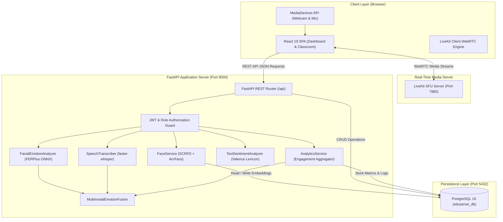
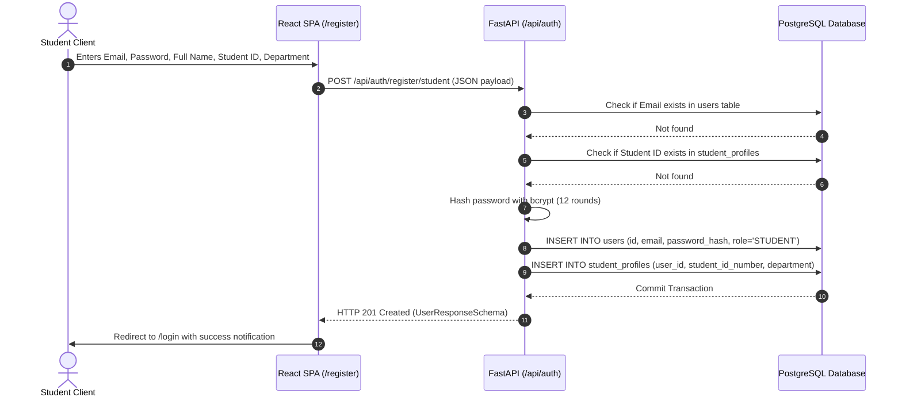
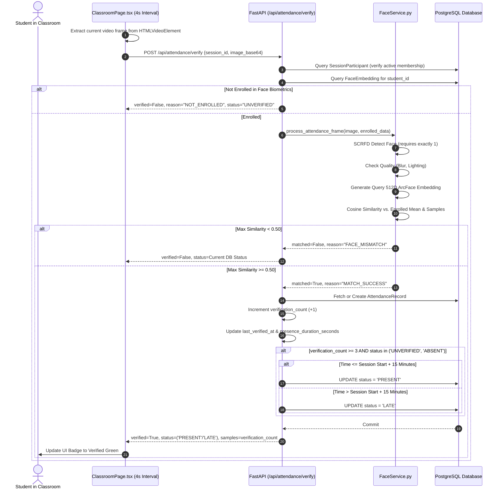
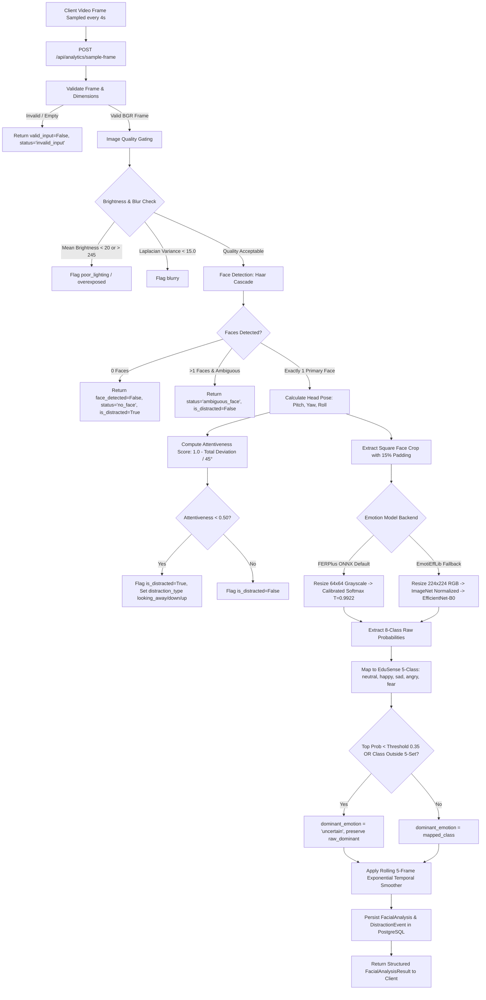
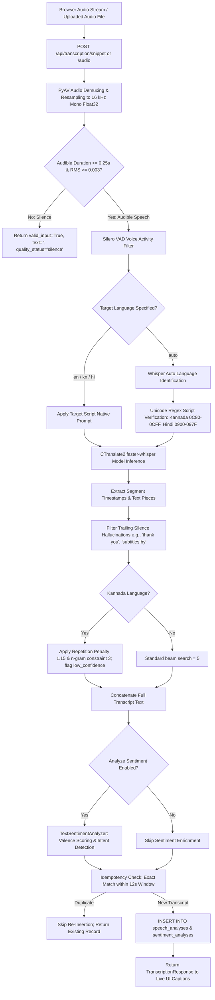
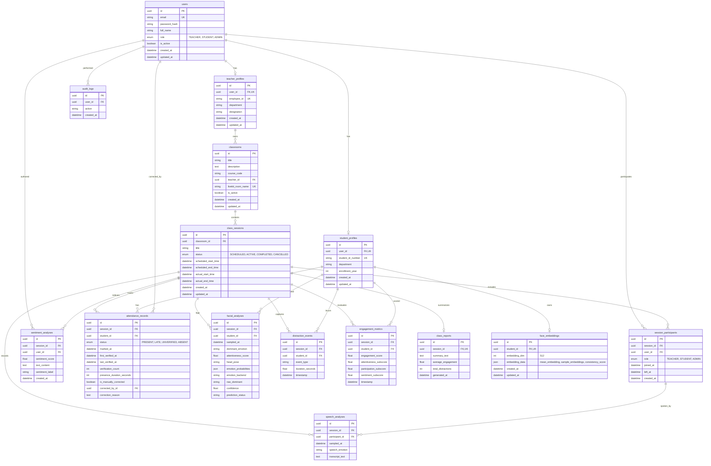

# EduSense AI: Complete Technical Documentation
## Architecture, Models, Database Design, APIs, and Implementation

---

## 1. Complete Technology Stack Audit

The following table provides a comprehensive, verified audit of all software components, frameworks, libraries, and tools utilized across the EduSense AI repository.

| Category | Component / Library | Version / Checkpoint | Primary Role & Purpose | Repository Location | Communication & Integration | Status |
| :--- | :--- | :--- | :--- | :--- | :--- | :--- |
| **Frontend** | React | `^19.2.8` | Core component UI rendering and state-driven virtual DOM updates | `frontend/package.json`, `frontend/src/` | Mounts to root DOM in `main.tsx`; manages single-page routing | Verified Implemented |
| **Frontend** | TypeScript | `~6.0.2` | Type-safe UI architecture, strict interface definitions, and compile-time validation | `frontend/tsconfig.json`, `frontend/src/types/` | Enforces payload typing between API services and React components | Verified Implemented |
| **Frontend** | Vite | `^8.2.2` | High-speed ESM development server, HMR, and production bundler | `frontend/vite.config.ts` | Serves client at `http://localhost:5173`; proxies API requests | Verified Implemented |
| **Frontend** | TailwindCSS | `^4.3.3` | Utility-first CSS styling with glassmorphism, responsive grids, and dark theme | `frontend/package.json`, `frontend/src/index.css` | Injected via `@tailwindcss/vite` plugin | Verified Implemented |
| **Frontend** | LiveKit React SDK | `@livekit/components-react ^2.9.24` | WebRTC video/audio track rendering, room connection, and participant management | `frontend/src/pages/ClassroomPage.tsx` | Subscribes to WebRTC media tracks via LiveKit SFU server | Verified Implemented |
| **Frontend** | LiveKit Client | `livekit-client ^2.22.2` | Underlying WebRTC peer connection, device enumeration, and data channel transport | `frontend/src/pages/ClassroomPage.tsx` | Manages WebRTC signaling, ICE candidates, and real-time data packets | Verified Implemented |
| **Frontend** | React Router DOM | `^7.18.3` | Client-side declarative routing and protected route authorization guards | `frontend/src/App.tsx` | Routes URLs (`/login`, `/register`, `/dashboard`, `/classroom/:id`) | Verified Implemented |
| **Frontend** | Lucide React | `^1.41.0` | Modern, consistent iconography for classroom and dashboard controls | `frontend/src/components/*` | Embedded SVG components | Verified Implemented |
| **Backend** | Python | `3.12+` | Backend execution runtime environment | `backend/venv/` | Runs FastAPI server and AI processing pipelines | Verified Implemented |
| **Backend** | FastAPI | `>=0.110.0` | High-performance asynchronous REST API framework | `backend/app/main.py`, `backend/app/api/` | Exposes JSON endpoints; generates OpenAPI Swagger docs at `/docs` | Verified Implemented |
| **Backend** | Uvicorn | `[standard]>=0.28.0` | Asynchronous Server Gateway Interface (ASGI) production web server | `backend/` | Serves HTTP/1.1 and WebSockets on port `8000` | Verified Implemented |
| **Backend** | SQLAlchemy | `>=2.0.28` | Object-Relational Mapping (ORM) and declarative database model mapping | `backend/app/models/`, `backend/app/db/` | Executes parameterized SQL queries with ACID transaction safety | Verified Implemented |
| **Backend** | Alembic | `>=1.13.1` | Relational database schema migration management and revision versioning | `backend/alembic/`, `backend/alembic.ini` | Synchronizes Python model definitions with PostgreSQL schema | Verified Implemented |
| **Backend** | Pydantic | `>=2.6.4` | Data validation, schema enforcement, and JSON serialization | `backend/app/schemas/` | Validates HTTP request bodies and serializes responses | Verified Implemented |
| **Backend** | Passlib & Bcrypt | `passlib>=1.7.4`, `bcrypt>=4.0.0` | Cryptographic password hashing and verification | `backend/app/core/security.py` | Generates secure one-way hashes for stored credentials | Verified Implemented |
| **Backend** | PyJWT | `>=2.8.0` | RFC 7519 JSON Web Token generation, encoding, and signature verification | `backend/app/core/security.py`, `backend/app/core/deps.py` | Encodes user identity and role in bearer tokens; validates on request | Verified Implemented |
| **Backend** | LiveKit Server API | `livekit-api>=1.2.0` | Server-side LiveKit JWT token generation with scoped VideoGrants | `backend/app/services/livekit_service.py` | Authorizes room access and queries active room presence | Verified Implemented |
| **Database** | PostgreSQL | `16+` | ACID-compliant relational database engine | Database name: `edusense_db` | Connected via `psycopg2-binary>=2.9.9` on port `5432` | Verified Implemented |
| **AI / CV** | InsightFace | `>=1.0.1` (`buffalo_sc`) | Face detection and biometric feature extraction pack | `backend/app/services/face_service.py` | Orchestrates SCRFD detector and ArcFace MobileFaceNet | Verified Implemented |
| **AI / CV** | SCRFD | `det_500m.onnx` | Deep lightweight face detection with multi-scale feature pyramids | Bundled in InsightFace `buffalo_sc` | Detects faces and computes 5-point facial landmarks | Verified Implemented |
| **AI / CV** | ArcFace | `w600k_mbf.onnx` | MobileFaceNet backbone extracting 512-dimensional normalized embeddings | Bundled in InsightFace `buffalo_sc` | Compares identity vectors via dot product (cosine similarity) | Verified Implemented |
| **AI / CV** | FERPlus ONNX | `emotion-ferplus.onnx` (35.0 MB) | Deep convolutional facial emotion recognition (8 classes, $64\times 64$ grayscale) | `ai/models/emotion-ferplus.onnx`, `ai/facial_emotion.py` | Executed via ONNX Runtime CPU with temperature scaling ($T=0.9922$) | Verified Implemented |
| **AI / CV** | EmotiEffLib | `enet_b0_8_best_vgaf` (`>=1.1.1`) | EfficientNet-B0 facial expression classifier (8 classes, $224\times 224$ RGB) | `ai/facial_emotion.py` | Serves as fallback backend when FERPlus is unavailable | Verified Implemented |
| **AI / CV** | OpenCV | `opencv-python>=4.8.0` | Image decoding, color transformations, Haar cascades, blur estimation | `ai/facial_emotion.py`, `backend/app/services/face_service.py` | Performs Laplacian variance, brightness estimation, and head pose | Verified Implemented |
| **AI / Audio**| faster-whisper | `>=1.1.0` (CTranslate2 `small`) | Speech-to-text transcription engine with int8 quantization | `ai/speech_transcriber.py`, `backend/app/services/transcription_service.py` | Transcribes 16 kHz audio for English, Kannada, and Hindi | Verified Implemented |
| **AI / Audio**| PyAV | Underlying `faster-whisper` | Multimedia container demuxing and audio decoding (WAV, MP3, WebM, FLAC) | `ai/speech_transcriber.py` | Decodes diverse audio formats into raw 16 kHz float32 arrays | Verified Implemented |
| **AI / NLP** | Rule-Based Lexicon | Custom VADER-like implementation | Text valence scoring, negation scaling, and question/confusion detection | `ai/sentiment_analyzer.py` | Analyzes student chat and transcripts ($[-1.0, +1.0]$ score) | Verified Implemented |
| **AI / Fusion**| Late Fusion Model| Handcrafted weighted sum | Combines facial expression and speech emotion probability distributions | `ai/multimodal_fusion.py` | Applies $P_{final} = 0.65 P_{face} + 0.35 P_{speech}$ with conflict detection | Verified Implemented |
| **AI / Audio**| wav2vec 2.0 | Acoustic Emotion Classifier | Raw vocal prosody emotion recognition from raw audio waveforms | Conceptual / Future Scope | Planned for future research phases | Planned (Future) |
| **AI / NLP** | BERT / RoBERTa | Fine-Tuned Transformer | Deep transformer-based sentiment and semantic confusion classification | Conceptual / Future Scope | Planned for future research phases | Planned (Future) |

---

## 2. System Architecture & Component Interactions

EduSense AI is built upon an asynchronous, three-tier decoupled architecture:

```
[ CLIENT TIER: React 19 + TypeScript + LiveKit Client ]
                   │                     │
      REST API     │                     │  WebRTC Media Tracks
      (JSON / HTTP)│                     │  (RTP / SRTP)
                   ▼                     ▼
[ APPLICATION TIER: FastAPI Backend ]  [ MEDIA TIER: LiveKit SFU Server ]
    ├── Authentication & RBAC             └── Selective Forwarding Unit
    ├── Classroom & Session Management         (Audio / Video / Screen)
    ├── Attendance Verification Engine
    ├── Background Analytics Aggregator
    └── AI Inference Pipelines (InsightFace, FERPlus, Whisper)
                   │
      SQLAlchemy   │
      (ACID / ORM) │
                   ▼
[ DATA TIER: PostgreSQL 16 Database ]
    └── 15 Relational Tables with UUID PKs & Foreign Key Cascades
```

### Component Decoupling Principle
A primary design requirement of EduSense AI is that **compute-intensive deep learning tasks must never sit in the critical path of real-time audio/video transmission**:
1. Video and audio transport flows directly between the browser client and the LiveKit Selective Forwarding Unit (SFU) using optimized WebRTC protocols (UDP/SRTP).
2. The client application samples video frames (at 4-second intervals) and audio segments, dispatching them asynchronously via HTTP REST to FastAPI.
3. The FastAPI server handles inference across separate worker threads via ONNX Runtime and CTranslate2, caching results and persisting aggregated records to PostgreSQL without blocking media transport.

---

## 3. Architecture & Workflow Diagrams (Mermaid)

### Diagram A: Overall System Architecture



### Diagram B: Student Registration & Profile Creation Workflow



### Diagram C: Guided Face Biometric Enrollment Workflow

```mermaid
sequenceDiagram
    autonumber
    actor Student as Enrolling Student
    participant UI as FaceEnrollmentPage.tsx
    participant FaceAPI as FastAPI (/api/face)
    participant FaceSvc as FaceService.py
    participant DB as PostgreSQL Database

    Student->>UI: Starts Guided 5-Step Enrollment
    loop For Each of 5 Poses (Front, Left, Right, Up, Down)
        UI->>UI: Capture Webcam Frame (Base64 JPEG)
        UI->>FaceAPI: POST /api/face/enrollment/capture
        FaceAPI->>FaceSvc: process_frame(image_base64)
        FaceSvc->>FaceSvc: SCRFD Face Detection
        alt Number of Faces != 1
            FaceSvc-->>FaceAPI: Reject (Zero or Multiple Faces)
            FaceAPI-->>UI: Feedback: "Position single face in view"
        else Quality Check (Blur < 30.0 or Brightness out of bounds)
            FaceSvc-->>FaceAPI: Reject (Blurry / Poor Lighting)
            FaceAPI-->>UI: Feedback: "Too blurry / Adjust lighting"
        else Quality Check Passes
            FaceSvc->>FaceSvc: Generate 512D ArcFace Embedding & L2-Normalize
            FaceSvc-->>FaceAPI: Return Sample Embedding Vector
            FaceAPI-->>UI: HTTP 200 OK (passed=True, embedding=[...])
            UI->>UI: Store embedding in local state; advance step
        end
    end

    UI->>FaceAPI: POST /api/face/enrollment/complete (5 sample embeddings)
    FaceAPI->>FaceSvc: verify_consistency(sample_embeddings)
    FaceSvc->>FaceSvc: Pairwise Cosine Similarity Check (Threshold >= 0.40)
    alt Average Consistency < 0.40
        FaceAPI-->>UI: HTTP 400 Bad Request ("Inconsistent face samples")
    else Average Consistency >= 0.40
        FaceSvc->>FaceSvc: Compute Mean Normalized Embedding Vector
        FaceAPI->>DB: UPSERT INTO face_embeddings (student_id, embedding_data JSON)
        DB-->>FaceAPI: Commit
        FaceAPI-->>UI: HTTP 200 OK (EnrollmentCompleteResponse)
        UI->>Student: Display Enrollment Verified Success Badge
    end
```

### Diagram D: Automated Attendance Verification Workflow



### Diagram E: Facial Expression & Attentiveness Workflow



### Diagram F: Speech Transcription & Captioning Workflow



### Diagram G: Text Sentiment Analysis & Educational Intent Workflow

```mermaid
flowchart TD
    A[Input Text String from Chat or Speech Transcript] --> B[Check Language / Script Regex]
    B --> C{Kannada or Hindi Script?}
    C -->|Yes| D[Return sentiment_label='unsupported_language', sentiment_score=None]
    C -->|No: English / ASCII| E[Tokenize Words using Regex Boundaries]
    
    E --> F{Word Tokens Found?}
    F -->|No| G[Return valid_input=False, sentiment_label='neutral']
    F -->|Yes| H[Match Tokens against BETA_LEXICON]
    
    H --> I{Preceding Token in NEGATIONS set?}
    I -->|Yes e.g., 'not clear'| J[Invert Valence: valence = -valence * 0.8]
    I -->|No| K[Accumulate Raw Valence Score]
    
    J --> L[Sum Scored Tokens: total_valence]
    K --> L
    L --> M[Compute Normalized Compound Score: S / sqrt(S^2 + 15.0)]
    
    M --> N[Evaluate Intent Markers]
    N --> O{Contains '?' or starts with Question Word?}
    O -->|Yes| P[is_question = True]
    O -->|No| Q[is_question = False]
    
    N --> R{Contains CONFUSION_TERMS e.g. 'confused', 'unclear'?}
    R -->|Yes| S1[is_confusion = True]
    R -->|No| T1[is_confusion = False]
    
    M --> U1{Compound Score Thresholds}
    U1 -->|Compound >= +0.05| V1[sentiment_label = 'positive']
    U1 -->|Compound <= -0.05| W1[sentiment_label = 'negative']
    U1 -->|Between -0.05 and +0.05 & is_confusion| X1[sentiment_label = 'negative']
    U1 -->|Between -0.05 and +0.05 & Neutral| Y1[sentiment_label = 'neutral']
    
    V1 --> Z1[Calculate Calibrated Confidence: min(0.95, 0.60 + 0.35 * |compound|)]
    W1 --> Z1
    X1 --> Z1
    Y1 --> Z1
    Z1 --> AA1[Return SentimentAnalysisResult]
```

### Diagram H: Multimodal Late Fusion Workflow

```mermaid
flowchart TD
    A[Facial Emotion Probabilities P_face] --> C{Are Visual Probs Available?}
    B[Speech Emotion Probabilities P_speech] --> D{Are Speech Probs Available?}
    
    C -->|No| E{Is Speech Available?}
    C -->|Yes| F{Is Speech Available?}
    
    E -->|No| G[Return dominant_emotion='insufficient_data', modality='none']
    E -->|Yes| H[Normalize Speech Distribution -> Return modality='speech_only', w_speech=1.0]
    
    F -->|No| I[Normalize Face Distribution -> Return modality='face_only', w_face=1.0]
    F -->|Yes| J[TRUE MULTIMODAL LATE FUSION]
    
    J --> K[Re-normalize Distributions across 5 Classes: neutral, happy, sad, angry, fear]
    K --> L[Calculate Weighted Probability: P_final = 0.65 * P_face + 0.35 * P_speech]
    L --> M[Extract Dominant Fused Emotion: max(P_final)]
    
    M --> N{Top Face Emotion != Top Speech Emotion AND Both Confidences >= 0.50?}
    N -->|Yes| O[Flag conflict_detected=True, Record Conflict Reason Descriptive String]
    N -->|No| P[Flag conflict_detected=False, conflict_reason=None]
    
    O --> Q[Return Fused Probabilities, Combined Confidence, and Modality Metadata]
    P --> Q
```

### Diagram I: Complete Database Entity-Relationship (ER) Diagram



### Diagram J: Complete Application End-to-End Data Flow

```mermaid
sequenceDiagram
    autonumber
    actor T as Teacher
    actor S as Student
    participant FE as React Frontend
    participant BE as FastAPI Backend
    participant LK as LiveKit SFU
    participant AI as AI Subsystems (Face, FER, Whisper)
    participant DB as PostgreSQL 16

    T-> FE: Logs in & Launches Class Session
    FE->>BE: POST /api/classrooms/{id}/sessions/{id}/start
    BE->>DB: UPDATE status='ACTIVE', actual_start_time=now()
    BE-->>FE: Returns LiveKit Token & Room Credentials
    FE->>LK: Connects Teacher WebRTC Video/Audio Track
    
    S->>FE: Logs in & Joins Active Class Session
    FE->>BE: POST /api/classrooms/{id}/sessions/{id}/join
    BE->>DB: INSERT / UPDATE session_participants
    BE-->>FE: Returns Student LiveKit Token
    FE->>LK: Connects Student WebRTC Video/Audio Track

    par Real-Time Media Loop
        LK-->>FE: Streams Video/Audio between Teacher and Student
    and Periodic Automated Attendance Loop (Every 4s)
        FE->>BE: POST /api/attendance/verify (Base64 Frame)
        BE->>AI: InsightFace SCRFD + ArcFace 512D
        AI-->>BE: Cosine Similarity Match (Threshold >= 0.50)
        BE->>DB: Increment verification_count; update AttendanceRecord (PRESENT after 3 samples)
        BE-->>FE: Return Verified Attendance Badge Status
    and Periodic Engagement Analytics Loop (Every 4s)
        FE->>BE: POST /api/analytics/sample-frame (Base64 Frame)
        BE->>AI: FERPlus ONNX (Emotion) + Haar Cascades (Head Pose)
        AI-->>BE: Emotion Probs, Attentiveness Score, Distraction Flag
        BE->>DB: INSERT INTO facial_analyses & distraction_events
        BE-->>FE: Return Floating Emotion Badge on Video Tile
    and Speech Transcription Loop (4s Audio Snippets)
        FE->>BE: POST /api/transcription/snippet (Base64 Audio)
        BE->>AI: faster-whisper CTranslate2 (English, Kannada, Hindi)
        AI->>AI: TextSentimentAnalyzer (Valence & Question/Confusion)
        AI-->>BE: Transcript Text & Sentiment Label
        BE->>DB: INSERT INTO speech_analyses & sentiment_analyses
        BE-->>FE: Stream Live Caption to Student & Teacher Screens
    and Teacher Analytics Monitoring
        T->>FE: Opens Teacher Attendance Roster / Analytics Dashboard
        FE->>BE: GET /api/attendance/session/{id} & GET /api/analytics/session/{id}/overview
        BE->>DB: Aggregate records across participants
        BE-->>FE: Return Class Engagement %, Attendance Rate, Expression Distribution
        FE->>T: Renders Visual Charts, Roster, and Engagement Analytics
    end
```

---

## 4. Database Schema Specifications

### PostgreSQL Engine Details
* **Database Engine**: PostgreSQL 16.x
* **Default Database Name**: `edusense_db`
* **Driver**: `psycopg2-binary` (via SQLAlchemy 2.0 ORM)
* **Identifier Primary Keys**: Universal Unique Identifier Version 4 (`UUIDv4`), stored natively as PostgreSQL `UUID` type.
* **Migration Framework**: Alembic 1.13+ managing linear migrations.

### Table Definitions & Column Constraints

#### 1. `users` Table
Stores primary identity and authentication credentials for all platform actors.
* `id` (`UUID`, Primary Key, default `uuid.uuid4`)
* `email` (`VARCHAR(255)`, Unique, Not Null, Indexed)
* `password_hash` (`VARCHAR(255)`, Not Null): Bcrypt salt and hash string
* `full_name` (`VARCHAR(255)`, Not Null)
* `role` (`VARCHAR(20)`, Enum: `TEACHER`, `STUDENT`, `ADMIN`, Not Null)
* `is_active` (`BOOLEAN`, Default `True`, Not Null)
* `created_at` (`TIMESTAMPTZ`, Server Default `now()`, Not Null)
* `updated_at` (`TIMESTAMPTZ`, Server Default `now()`, On Update `now()`, Not Null)

#### 2. `student_profiles` Table
Stores academic information specific to students; linked 1-to-1 with `users`.
* `id` (`UUID`, Primary Key)
* `user_id` (`UUID`, Foreign Key `users.id` ON DELETE CASCADE, Unique, Indexed, Not Null)
* `student_id_number` (`VARCHAR(100)`, Unique, Indexed, Not Null): College enrollment / USN
* `department` (`VARCHAR(100)`, Nullable)
* `enrollment_year` (`INTEGER`, Nullable)
* `created_at` (`TIMESTAMPTZ`, Server Default `now()`, Not Null)
* `updated_at` (`TIMESTAMPTZ`, Server Default `now()`, On Update `now()`, Not Null)

#### 3. `teacher_profiles` Table
Stores faculty information; linked 1-to-1 with `users`.
* `id` (`UUID`, Primary Key)
* `user_id` (`UUID`, Foreign Key `users.id` ON DELETE CASCADE, Unique, Indexed, Not Null)
* `employee_id` (`VARCHAR(100)`, Unique, Indexed, Not Null)
* `department` (`VARCHAR(100)`, Nullable)
* `designation` (`VARCHAR(100)`, Nullable)
* `created_at` (`TIMESTAMPTZ`, Server Default `now()`, Not Null)
* `updated_at` (`TIMESTAMPTZ`, Server Default `now()`, On Update `now()`, Not Null)

#### 4. `classrooms` Table
Defines an academic course or subject room owned by a teacher.
* `id` (`UUID`, Primary Key)
* `title` (`VARCHAR(255)`, Not Null)
* `description` (`TEXT`, Nullable)
* `course_code` (`VARCHAR(50)`, Indexed, Not Null): e.g. `CS801`, `AIML402`
* `teacher_id` (`UUID`, Foreign Key `teacher_profiles.id` ON DELETE CASCADE, Indexed, Not Null)
* `livekit_room_name` (`VARCHAR(255)`, Unique, Indexed, Not Null): Format `classroom_{uuid}`
* `is_active` (`BOOLEAN`, Default `True`, Not Null)
* `created_at` (`TIMESTAMPTZ`, Server Default `now()`, Not Null)
* `updated_at` (`TIMESTAMPTZ`, Server Default `now()`, On Update `now()`, Not Null)

#### 5. `class_sessions` Table
Tracks individual lectures or live video meetings conducted within a classroom.
* `id` (`UUID`, Primary Key)
* `classroom_id` (`UUID`, Foreign Key `classrooms.id` ON DELETE CASCADE, Indexed, Not Null)
* `title` (`VARCHAR(255)`, Not Null)
* `status` (`VARCHAR(20)`, Enum: `SCHEDULED`, `ACTIVE`, `COMPLETED`, `CANCELLED`, Indexed, Not Null)
* `scheduled_start_time` (`TIMESTAMPTZ`, Not Null)
* `scheduled_end_time` (`TIMESTAMPTZ`, Not Null)
* `actual_start_time` (`TIMESTAMPTZ`, Nullable)
* `actual_end_time` (`TIMESTAMPTZ`, Nullable)
* `created_at` (`TIMESTAMPTZ`, Server Default `now()`, Not Null)
* `updated_at` (`TIMESTAMPTZ`, Server Default `now()`, On Update `now()`, Not Null)

#### 6. `session_participants` Table
Associates users with sessions; tracks live participation intervals.
* `id` (`UUID`, Primary Key)
* `session_id` (`UUID`, Foreign Key `class_sessions.id` ON DELETE CASCADE, Indexed, Not Null)
* `user_id` (`UUID`, Foreign Key `users.id` ON DELETE CASCADE, Indexed, Not Null)
* `role` (`VARCHAR(20)`, Enum: `TEACHER`, `STUDENT`, `ADMIN`, Not Null)
* `joined_at` (`TIMESTAMPTZ`, Server Default `now()`, Not Null)
* `left_at` (`TIMESTAMPTZ`, Nullable)
* `created_at` (`TIMESTAMPTZ`, Server Default `now()`, Not Null)

#### 7. `face_embeddings` Table
Stores mathematical biometric enrollment templates; raw images are never persisted.
* `id` (`UUID`, Primary Key)
* `student_id` (`UUID`, Foreign Key `student_profiles.id` ON DELETE CASCADE, Indexed, Unique, Not Null)
* `embedding_dim` (`INTEGER`, Default `512`, Not Null)
* `embedding_data` (`JSONB` / `JSON`, Not Null):
  ```json
  {
    "mean_embedding": [0.0234, -0.0121, ..., 0.0541],
    "sample_embeddings": [
      [0.0212, ...], [0.0245, ...], [0.0221, ...], [0.0238, ...], [0.0255, ...]
    ],
    "num_samples": 5,
    "consistency_score": 0.8842,
    "enrolled_at": "2026-10-19T09:00:00Z"
  }
  ```
* `created_at` (`TIMESTAMPTZ`, Server Default `now()`, Not Null)
* `updated_at` (`TIMESTAMPTZ`, Server Default `now()`, On Update `now()`, Not Null)

#### 8. `attendance_records` Table
Maintains one attendance status record per student per session to prevent duplicates.
* `id` (`UUID`, Primary Key)
* `session_id` (`UUID`, Foreign Key `class_sessions.id` ON DELETE CASCADE, Indexed, Not Null)
* `student_id` (`UUID`, Foreign Key `student_profiles.id` ON DELETE CASCADE, Indexed, Not Null)
* `status` (`VARCHAR(20)`, Enum: `PRESENT`, `LATE`, `UNVERIFIED`, `ABSENT`, Not Null)
* `marked_at` (`TIMESTAMPTZ`, Server Default `now()`, Not Null)
* `first_verified_at` (`TIMESTAMPTZ`, Nullable)
* `last_verified_at` (`TIMESTAMPTZ`, Nullable)
* `verification_count` (`INTEGER`, Default `0`, Not Null)
* `presence_duration_seconds` (`INTEGER`, Default `0`, Not Null)
* `is_manually_corrected` (`BOOLEAN`, Default `False`, Not Null)
* `corrected_by_id` (`UUID`, Foreign Key `users.id` ON DELETE SET NULL, Nullable)
* `correction_reason` (`TEXT`, Nullable)

#### 9. `facial_analyses` Table
Interval observation records generated by asynchronous video frame analysis.
* `id` (`UUID`, Primary Key)
* `session_id` (`UUID`, Foreign Key `class_sessions.id` ON DELETE CASCADE, Indexed, Not Null)
* `student_id` (`UUID`, Foreign Key `student_profiles.id` ON DELETE CASCADE, Indexed, Not Null)
* `sampled_at` (`TIMESTAMPTZ`, Server Default `now()`, Not Null)
* `dominant_emotion` (`VARCHAR(50)`, Nullable): `neutral`, `happy`, `sad`, `angry`, `fear`, or `uncertain`
* `attentiveness_score` (`FLOAT`, Nullable): Range `[0.0, 1.0]`
* `head_pose` (`VARCHAR(50)`, Nullable): `frontal`, `turned_left`, `turned_right`, `looking_down`, `looking_up`
* `emotion_probabilities` (`JSONB` / `JSON`, Nullable): Calibrated 5-class distribution
* `emotion_backend` (`VARCHAR(30)`, Nullable): `ferplus` or `emotiefflib`
* `raw_dominant` (`VARCHAR(50)`, Nullable): Unmapped 8-class prediction (e.g. `Surprise`, `Contempt`)
* `confidence` (`FLOAT`, Nullable)
* `prediction_status` (`VARCHAR(30)`, Nullable): `valid_prediction`, `low_confidence`, `no_face`, `ambiguous_face`, `poor_image_quality`

#### 10. `speech_analyses` Table
Records speech segments, transcription text, and acoustic emotion tags.
* `id` (`UUID`, Primary Key)
* `session_id` (`UUID`, Foreign Key `class_sessions.id` ON DELETE CASCADE, Indexed, Not Null)
* `participant_id` (`UUID`, Foreign Key `session_participants.id` ON DELETE CASCADE, Indexed, Not Null)
* `sampled_at` (`TIMESTAMPTZ`, Server Default `now()`, Not Null)
* `speech_emotion` (`VARCHAR(50)`, Nullable): Inherited sentiment or acoustic emotion tag
* `transcript_text` (`TEXT`, Nullable)

#### 11. `sentiment_analyses` Table
Text sentiment scores derived from chat messages and speech transcripts.
* `id` (`UUID`, Primary Key)
* `session_id` (`UUID`, Foreign Key `class_sessions.id` ON DELETE CASCADE, Indexed, Not Null)
* `user_id` (`UUID`, Foreign Key `users.id` ON DELETE CASCADE, Indexed, Not Null)
* `sentiment_score` (`FLOAT`, Nullable): Compound valence score in `[-1.0, +1.0]`
* `text_content` (`TEXT`, Nullable)
* `sentiment_label` (`VARCHAR(20)`, Nullable): `positive`, `negative`, `neutral`, or `unsupported_language`
* `created_at` (`TIMESTAMPTZ`, Server Default `now()`, Not Null)

#### 12. `distraction_events` Table
Logs individual inattention or distraction occurrences.
* `id` (`UUID`, Primary Key)
* `session_id` (`UUID`, Foreign Key `class_sessions.id` ON DELETE CASCADE, Indexed, Not Null)
* `student_id` (`UUID`, Foreign Key `student_profiles.id` ON DELETE CASCADE, Indexed, Not Null)
* `event_type` (`VARCHAR(100)`, Nullable): `looking_away`, `looking_down`, `looking_up`, `no_face_detected`
* `duration_seconds` (`FLOAT`, Default `5.0`, Nullable)
* `timestamp` (`TIMESTAMPTZ`, Server Default `now()`, Not Null)

#### 13. `engagement_metrics` Table
Time-series snapshots of student engagement scores.
* `id` (`UUID`, Primary Key)
* `session_id` (`UUID`, Foreign Key `class_sessions.id` ON DELETE CASCADE, Indexed, Not Null)
* `student_id` (`UUID`, Foreign Key `student_profiles.id` ON DELETE CASCADE, Indexed, Not Null)
* `engagement_score` (`FLOAT`, Nullable): Composite score `[0.0, 100.0]`
* `attentiveness_subscore` (`FLOAT`, Nullable): `[0.0, 100.0]`
* `participation_subscore` (`FLOAT`, Nullable): `[0.0, 100.0]`
* `sentiment_subscore` (`FLOAT`, Nullable): `[0.0, 100.0]`
* `timestamp` (`TIMESTAMPTZ`, Server Default `now()`, Not Null)

#### 14. `class_reports` Table
Session-level summarized report generated at session completion.
* `id` (`UUID`, Primary Key)
* `session_id` (`UUID`, Foreign Key `class_sessions.id` ON DELETE CASCADE, Unique, Indexed, Not Null)
* `summary_text` (`TEXT`, Nullable)
* `average_engagement` (`FLOAT`, Nullable)
* `total_distractions` (`INTEGER`, Default `0`, Nullable)
* `generated_at` (`TIMESTAMPTZ`, Server Default `now()`, Not Null)

#### 15. `audit_logs` Table
Transparent log of administrative and instructor actions.
* `id` (`UUID`, Primary Key)
* `user_id` (`UUID`, Foreign Key `users.id` ON DELETE SET NULL, Indexed, Nullable)
* `action` (`VARCHAR(255)`, Not Null)
* `created_at` (`TIMESTAMPTZ`, Server Default `now()`, Not Null)

---

## 5. Comprehensive API Endpoint Reference

The following table documents every active REST API endpoint exposed by the FastAPI backend.

| HTTP Method | Route | Description & Purpose | Auth Role | Request Body / Parameters | Response Schema | Source File |
| :--- | :--- | :--- | :--- | :--- | :--- | :--- |
| `GET` | `/api/health` | Health check and PostgreSQL connection verification | Public | None | `HealthResponse` | `backend/app/api/health.py` |
| `POST` | `/api/auth/register/teacher` | Register teacher account with `TeacherProfile` | Public | `TeacherRegisterSchema` | `UserResponseSchema` (201) | `backend/app/api/auth.py` |
| `POST` | `/api/auth/register/student` | Register student account with `StudentProfile` | Public | `StudentRegisterSchema` | `UserResponseSchema` (201) | `backend/app/api/auth.py` |
| `POST` | `/api/auth/login` | Authenticate user credentials & issue JWT token | Public | `LoginSchema` (`email`, `password`) | `TokenResponseSchema` | `backend/app/api/auth.py` |
| `GET` | `/api/auth/me` | Fetch authenticated user profile & roles | Bearer JWT | None | `UserResponseSchema` | `backend/app/api/auth.py` |
| `POST` | `/api/classrooms/` | Create a new classroom | `TEACHER` | `ClassroomCreateSchema` | `ClassroomResponseSchema` (201) | `backend/app/api/classrooms.py` |
| `GET` | `/api/classrooms/` | List classrooms authorized for current user | Bearer JWT | None | `List[ClassroomResponseSchema]` | `backend/app/api/classrooms.py` |
| `GET` | `/api/classrooms/{id}` | Retrieve classroom detail by UUID | Bearer JWT | Path: `classroom_id` | `ClassroomResponseSchema` | `backend/app/api/classrooms.py` |
| `POST` | `/api/classrooms/{id}/sessions` | Create a new class session | `TEACHER` | Path: `id`, Body: `ClassSessionCreateSchema` | `ClassSessionResponseSchema` (201) | `backend/app/api/sessions.py` |
| `POST` | `/api/sessions/{id}/start` | Transition session to `ACTIVE` | `TEACHER` | Path: `session_id` | `ClassSessionResponseSchema` | `backend/app/api/sessions.py` |
| `POST` | `/api/sessions/{id}/end` | Transition session to `COMPLETED` | `TEACHER` | Path: `session_id` | `ClassSessionResponseSchema` | `backend/app/api/sessions.py` |
| `GET` | `/api/sessions/recent` | List recently completed sessions | Bearer JWT | None | `List[ClassSessionResponseSchema]` | `backend/app/api/sessions.py` |
| `GET` | `/api/sessions/upcoming` | List scheduled upcoming sessions | Bearer JWT | None | `List[ClassSessionResponseSchema]` | `backend/app/api/sessions.py` |
| `GET` | `/api/sessions/{id}` | Get session metadata and status | Bearer JWT | Path: `session_id` | `ClassSessionResponseSchema` | `backend/app/api/sessions.py` |
| `GET` | `/api/classrooms/{id}/active-session` | Get currently running active session | Bearer JWT | Path: `classroom_id` | `ClassSessionResponseSchema` | `backend/app/api/sessions.py` |
| `POST` | `/api/classrooms/{c_id}/sessions/{s_id}/join` | Join session and generate LiveKit AccessToken | Bearer JWT | Path: `c_id`, `s_id` | `JoinSessionResponseSchema` | `backend/app/api/sessions.py` |
| `POST` | `/api/sessions/{id}/leave` | Record participant departure timestamp | Bearer JWT | Path: `session_id` | `{"message": "..."}` | `backend/app/api/sessions.py` |
| `POST` | `/api/face/enrollment/capture` | Validate frame quality and generate embedding | `STUDENT` | `FaceCaptureRequest` (base64) | `FaceCaptureResponse` | `backend/app/api/face.py` |
| `POST` | `/api/face/enrollment/complete` | Complete enrollment with 5 consistent samples | `STUDENT` | `EnrollmentCompleteRequest` (5 vectors) | `EnrollmentCompleteResponse` | `backend/app/api/face.py` |
| `GET` | `/api/face/enrollment/status` | Get biometric enrollment status | Bearer JWT | None | `EnrollmentStatusResponse` | `backend/app/api/face.py` |
| `DELETE`| `/api/face/enrollment` | Delete face enrollment record for re-enrollment | `STUDENT` | None | `{"message": "..."}` | `backend/app/api/face.py` |
| `POST` | `/api/face/verification` | Test face verification against enrolled profile | `STUDENT` | `FaceVerificationRequest` (base64) | `FaceVerificationResponse` | `backend/app/api/face.py` |
| `POST` | `/api/attendance/verify` | Process video frame for automated attendance | `STUDENT` | `AttendanceVerificationRequest` | `AttendanceVerificationResponse`| `backend/app/api/attendance.py` |
| `GET` | `/api/attendance/session/{id}` | Get attendance roster and summary counts | Bearer JWT | Path: `session_id` | `SessionAttendanceSummaryResponse`| `backend/app/api/attendance.py` |
| `PUT` | `/api/attendance/{record_id}` | Manually update student attendance record | `TEACHER` | Path: `record_id`, Body: `ManualUpdateRequest` | `AttendanceRecordResponse` | `backend/app/api/attendance.py` |
| `GET` | `/api/attendance/my-summary` | Get personal attendance stats for student | `STUDENT` | None | `StudentAttendanceSummaryResponse`| `backend/app/api/attendance.py` |
| `GET` | `/api/attendance/teacher-summary` | Get aggregated attendance stats across classes | `TEACHER` | None | `TeacherAttendanceSummaryResponse`| `backend/app/api/attendance.py` |
| `POST` | `/api/analytics/sample-frame` | Analyze video frame for facial pose & emotion | Bearer JWT | `FacialFrameInput` (base64) | `FacialAnalysisResult` | `backend/app/api/analytics.py` |
| `POST` | `/api/analytics/sentiment` | Analyze chat/transcript text sentiment | Bearer JWT | `TextSentimentInput` | `SentimentAnalysisResult` | `backend/app/api/analytics.py` |
| `GET` | `/api/analytics/session/{s_id}/student/{st_id}` | Get individual student engagement summary | Bearer JWT | Path: `s_id`, `st_id` | `StudentEngagementSummary` | `backend/app/api/analytics.py` |
| `GET` | `/api/analytics/session/{id}/overview` | Session-wide engagement overview & report | `TEACHER` | Path: `session_id` | `SessionAnalyticsOverview` | `backend/app/api/analytics.py` |
| `GET` | `/api/analytics/session/{id}/facial-window` | 5-minute rolling window classroom expressions | `TEACHER` | Path: `session_id`, Query: `window_time` | `FacialWindowAnalytics` | `backend/app/api/analytics.py` |
| `GET` | `/api/analytics/session/{s_id}/student/{st_id}/facial-window` | 5-minute personal facial expression window | Bearer JWT | Path: `s_id`, `st_id`, Query: `window_time`| `StudentFacialWindowAnalytics` | `backend/app/api/analytics.py` |
| `GET` | `/api/analytics/session/{id}/facial-summary` | Session-wide facial summary across all windows | Bearer JWT | Path: `session_id` | `SessionFacialSummary` | `backend/app/api/analytics.py` |
| `GET` | `/api/transcription/languages` | List supported transcription languages | Bearer JWT | None | `List[LanguageOption]` | `backend/app/api/transcription.py` |
| `POST` | `/api/transcription/audio` | Transcribe multipart audio file with Whisper | Bearer JWT | Form: `file`, `session_id`, `language` | `TranscriptionResponse` | `backend/app/api/transcription.py` |
| `POST` | `/api/transcription/snippet` | Transcribe base64 audio snippet with Whisper | Bearer JWT | `AudioSnippetInput` | `TranscriptionResponse` | `backend/app/api/transcription.py` |
| `GET` | `/api/transcription/session/{id}/history` | Retrieve transcript history for session | Bearer JWT | Path: `session_id`, Query: `limit` | `List[SessionTranscriptItem]` | `backend/app/api/transcription.py` |
| `POST` | `/api/transcription/analyze-text` | Re-analyze transcript text without re-upload | Bearer JWT | `TextSentimentRequest` | `SentimentAnalysisResult` | `backend/app/api/transcription.py` |

---

## 6. Implementation Deep-Dive

### A. Face Detection & Recognition Pipeline (`backend/app/services/face_service.py`)

1. **Singleton Model Loading**:
   * InsightFace `FaceAnalysis(name='buffalo_sc', allowed_modules=['detection', 'recognition'])` is instantiated once upon service startup.
   * `det_size=(640, 640)` prepares the SCRFD model for multi-scale face localization.
   * Uses `CPUExecutionProvider` for high stability across deployment environments.
2. **Quality Gating Algorithm**:
   * **Size Constraint**: The bounding box dimensions must satisfy $w \ge 100\text{ px}$ and $h \ge 100\text{ px}$.
   * **Sharpness (Blur Check)**: The cropped face is converted to grayscale, and the variance of its discrete Laplacian is computed:
     $$\text{Var}(\Delta I) = \frac{1}{N}\sum (L(x,y) - \mu_L)^2 \ge 30.0$$
     Frames with variance below $30.0$ are rejected with `"Image too blurry. Hold steady."`
   * **Illumination Bounds**: Average pixel intensity must satisfy $40 \le \mu_I \le 235$.
   * **Positioning Centering**: The horizontal offset $\Delta x = \frac{c_x - W/2}{W}$ and vertical offset $\Delta y = \frac{c_y - H/2}{H}$ must remain within $\pm 18\%$ of the frame center.
3. **512-Dimensional Embedding & Normalization**:
   * ArcFace MobileFaceNet extracts a 512-dimensional feature vector $\vec{e}$.
   * L2-normalization is strictly applied:
     $$\hat{e} = \frac{\vec{e}}{\|\vec{e}\|_2} = \frac{\vec{e}}{\sqrt{\sum_{i=1}^{512} e_i^2}}$$
4. **Biometric Similarity Comparison**:
   * Cosine similarity between two unit-normalized embeddings equals their dot product:
     $$\text{sim}(\hat{e}_1, \hat{e}_2) = \hat{e}_1 \cdot \hat{e}_2 = \sum_{i=1}^{512} e_{1,i} e_{2,i}$$
   * A verification match is confirmed if $\text{sim} \ge 0.50$ (`settings.FACE_RECOGNITION_SIMILARITY_THRESHOLD`).

### B. Facial Emotion Recognition & Temporal Smoothing (`ai/facial_emotion.py`)

1. **Primary Model Backend (FERPlus ONNX)**:
   * **File**: `ai/models/emotion-ferplus.onnx` ($35.0$ MB).
   * **Input**: 1-channel Grayscale image resized to $64\times 64$, normalized to float32 tensor of shape $[1, 1, 64, 64]$.
   * **Temperature-Calibrated Softmax**: Logits $z_i$ are scaled by empirical validation temperature $T = 0.9922$:
     $$P(y = i) = \frac{\exp(z_i / T)}{\sum_{j=1}^8 \exp(z_j / T)}$$
   * **Output Classes**: `neutral`, `happy`, `surprise`, `sad`, `angry`, `disgust`, `fear`, `contempt`.
2. **Fallback Model Backend (EmotiEffLib)**:
   * `enet_b0_8_best_vgaf` executed via ONNX Runtime.
   * **Input**: 3-channel RGB image resized to $224\times 224$, normalized using ImageNet statistics ($\mu = [0.485, 0.456, 0.406]$, $\sigma = [0.229, 0.224, 0.225]$).
3. **Class Space Mapping & Uncertainty Preservation**:
   * Allowed 5-class target space: `{"neutral", "happy", "sad", "angry", "fear"}`.
   * Classes `surprise`, `disgust`, and `contempt` are mapped to `dominant_emotion = "uncertain"` while preserving the raw prediction in `raw_dominant` and the full distribution in `raw_emotion_probabilities`.
   * Predictions with top probability $< 0.35$ are flagged as `low_confidence`.
4. **Exponential Moving Average Temporal Smoother (`EmotionTemporalSmoother`)**:
   * Maintains rolling history of 5 consecutive frames with decay factor $\alpha = 0.85$:
     $$w_k = \alpha^{N - 1 - k}, \quad P_{\text{smoothed}}(c) = \frac{\sum_k w_k P_k(c)}{\sum_k w_k}$$
   * Resets instantly upon face loss or tracking discontinuity, eliminating inter-frame probability jitter.
5. **Head Pose & Attentiveness Estimation**:
   * Frontal face and ocular landmarks detected via OpenCV Haar Cascades.
   * Angles derived geometrically:
     $$\text{Yaw} = \left(\frac{c_x - W/2}{W/2}\right) \times 45^\circ, \quad \text{Pitch} = -\left(\frac{c_y - H/2}{H/2}\right) \times 30^\circ, \quad \text{Roll} = \arctan\left(\frac{\Delta y_{\text{eyes}}}{\Delta x_{\text{eyes}}}\right)$$
   * Attentiveness score:
     $$\text{Attentiveness} = \max\left(0.0, 1.0 - \frac{\sqrt{\text{Pitch}^2 + \text{Yaw}^2 + (0.5 \cdot \text{Roll})^2}}{45^\circ}\right)$$
   * Distraction event logged if attentiveness $< 0.50$ (classified as `looking_away`, `looking_down`, or `looking_up`).

### C. Multilingual Speech Recognition & Sentiment Analysis (`ai/speech_transcriber.py` & `ai/sentiment_analyzer.py`)

1. **Faster-Whisper Engine**:
   * Model checkpoint: `small` (CTranslate2 int8 quantization on CPU/MPS).
   * Audio input: PyAV resamples incoming audio to $16,000$ Hz, 1-channel float32.
   * VAD Filter: Silero VAD filters non-speech audio segments with `min_silence_duration_ms=400` and `speech_pad_ms=200`.
   * Native Prompt Conditioning:
     * Hindi (`hi`): `"यह एक शैक्षिक व्याख्यान और कक्षा की चर्चा है।"`
     * English (`en`): `"EduSense AI educational classroom lecture and student discussion."`
   * Low-Resource Dravidian Optimization: For Kannada (`kn`), subword looping is suppressed using `repetition_penalty=1.15` and `no_repeat_ngram_size=3`.
2. **Text Sentiment Scoring Algorithm**:
   * Tokens extracted via word-boundary regular expressions.
   * Valence values mapped from `BETA_LEXICON` ($[-3.0, +3.0]$).
   * Negation handling: If a preceding token is in `{"not", "no", "never", "don't", ...}`, the valence is inverted with a dampening factor of $0.8$:
     $$v_{\text{negated}} = -0.8 \cdot v_{\text{original}}$$
   * VADER-like normalization to $[-1.0, +1.0]$:
     $$\text{Compound} = \frac{\sum v}{\sqrt{(\sum v)^2 + 15.0}}$$
   * Educational Intent: Detects question marks / interrogative words (`what`, `why`, `how`, ...) and confusion phrases (`"don't understand"`, `"lost"`, `"unclear"`).
   * Language Policy: Non-English scripts (Kannada, Hindi) are safely declared `unsupported_language` for rule-based sentiment.

### D. Multimodal Late Fusion & Engagement Scoring (`ai/multimodal_fusion.py` & `backend/app/services/analytics_service.py`)

1. **Weighted Late Fusion**:
   * Combines probability distributions over canonical classes (`neutral`, `happy`, `sad`, `angry`, `fear`):
     $$P_{\text{fused}}(c) = w_{\text{face}} \cdot P_{\text{face}}(c) + w_{\text{speech}} \cdot P_{\text{speech}}(c)$$
   * Default configuration: $w_{\text{face}} = 0.65, w_{\text{speech}} = 0.35$.
   * Single-modality fallback: Automatically re-normalizes present modality to $1.0$ if the other is unavailable.
   * Signal Conflict Detection: Discrepancy flagged if top predicted classes diverge and both exhibit individual confidences $\ge 0.50$.
2. **Composite Student Engagement Index**:
   * Computes unified student engagement score ($0$ to $100\%$):
     $$E = \frac{w_{\text{att}} S_{\text{att}} + w_{\text{part}} S_{\text{part}} + w_{\text{sent}} S_{\text{sent}}}{w_{\text{att}} + w_{\text{part}} + w_{\text{sent}}}$$
   * Base weights: $w_{\text{att}} = 0.60$ (attentiveness), $w_{\text{part}} = 0.25$ (participation frequency), $w_{\text{sent}} = 0.15$ (normalized sentiment subscore).
   * Sentiment subscore normalized from $[-1.0, +1.0]$:
     $$S_{\text{sent}} = \left(\frac{\text{Compound} + 1.0}{2.0}\right) \times 100$$
   * Dynamic Weight Re-normalization: If sentiment or participation data is missing, weights dynamically re-balance over available signals so missing data is never penalized as zero.
